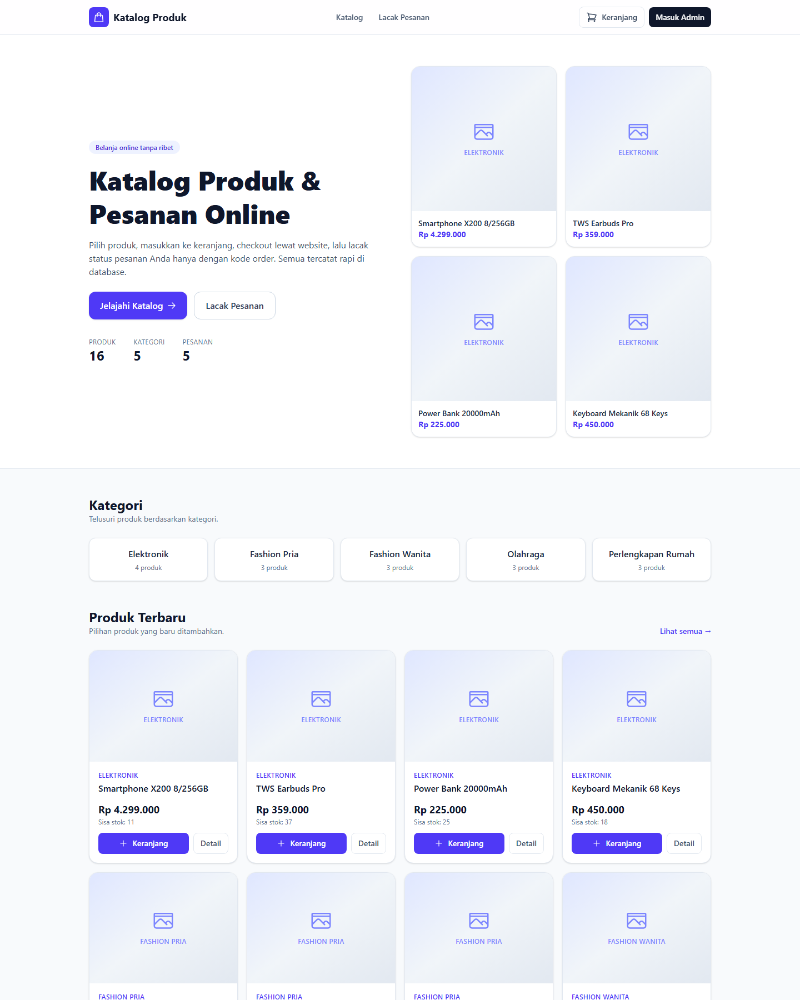
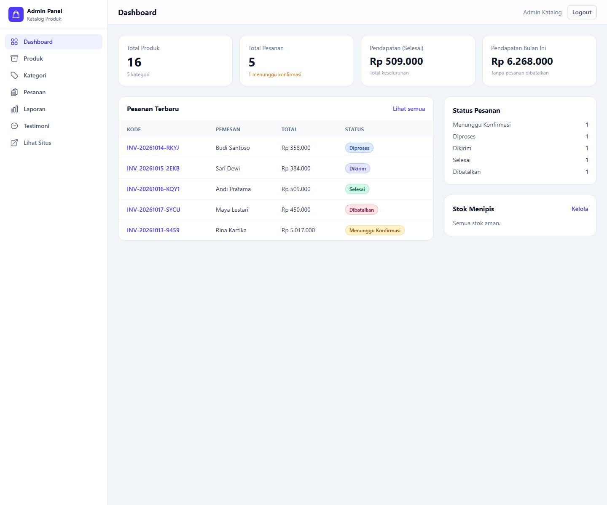

# Katalog Produk + Sistem Pesanan Online

[](https://github.com/Central-Saga/Rangga-Project2-KatalogProduk/actions/workflows/ci.yml)

Website **full-stack** katalog produk dengan sistem pesanan **tanpa WhatsApp** — semua alur
(belanja, checkout, pelacakan pesanan) dilakukan **lewat website** dan tersimpan di database.

Terdapat **dua sisi**:
- **Landing page publik** — untuk pengunjung (katalog, filter, pencarian, detail produk, keranjang, checkout, lacak pesanan, testimoni).
- **Dashboard admin** (login, protected) — mengelola produk, kategori, pesanan, laporan, dan testimoni (CRUD penuh).

> Tugas V2 — Tema 2 (Katalog Produk + Sistem Pesanan Online).

---

## Fitur

### Sisi Publik
- Katalog produk dengan **filter kategori**, **pencarian**, dan **pengurutan** (terbaru / harga / nama).
- Halaman **detail produk** + produk serupa.
- **Keranjang belanja** berbasis session (tambah, ubah jumlah, hapus, kosongkan).
- **Checkout** lewat form di website (nama, nomor HP, email, alamat, catatan) → pesanan tersimpan di database dengan **kode order unik**.
- **Lacak pesanan** menggunakan kode order, lengkap dengan **timeline status**.
- **Testimoni** dari pelanggan (tampil di landing setelah disetujui admin).

### Dashboard Admin (protected)
- **Dashboard** ringkasan: total produk, pesanan, pendapatan, pesanan menunggu, stok menipis.
- **CRUD Produk** + **upload foto** + stok + status aktif/nonaktif.
- **CRUD Kategori**.
- **Kelola Pesanan**: lihat semua pesanan, ubah status
  (`menunggu konfirmasi → diproses → dikirim → selesai / dibatalkan`).
- **Laporan penjualan** sederhana: total order, pendapatan, pendapatan harian, produk terlaris, per status (per periode tanggal).
- **Kelola Testimoni**: setujui / batalkan / hapus.

---

## Stack Teknologi

| Layer | Teknologi |
|---|---|
| Framework | **Laravel 12** (PHP 8.2+) |
| View | **Blade + Tailwind CSS 4** (Vite 7) |
| Database | **SQLite** (default, tanpa setup) — bisa diganti **MySQL/PostgreSQL** |
| Auth | Session + password **bcrypt** (hashed), halaman dashboard dilindungi middleware `auth` |
| Validasi | **FormRequest** (server-side) + pesan error bahasa Indonesia |
| Upload | File gambar disimpan di `public/uploads/products/` |

---

## Struktur Folder (ringkas)

```
katalog-produk/
├── app/
│   ├── Http/
│   │   ├── Controllers/
│   │   │   ├── Auth/LoginController.php
│   │   │   ├── Admin/            # Dashboard, Category, Product, Order, Report, Testimonial
│   │   │   └── ...               # Home, Catalog, Cart, Checkout, OrderTracking, Testimonial
│   │   └── Requests/            # Validasi form
│   ├── Models/                  # Category, Product, Order, OrderItem, Testimonial, User
│   └── Support/                 # Cart (session), Slug
├── database/
│   ├── migrations/              # categories, products, orders, order_items, testimonials
│   └── seeders/                 # User, Category, Product, Testimonial
├── resources/views/            # layouts, partials, landing, admin, auth, errors
├── routes/web.php
├── docs/
│   ├── ERD.md
│   └── screenshots/            # screenshot landing + dashboard
└── .env.example
```

---

## Menjalankan Proyek

### Prasyarat
- PHP **8.2+**, Composer 2, Node.js **18+** & npm

### Langkah
```bash
git clone <url-repo> katalog-produk
cd katalog-produk

composer install
cp .env.example .env          # Windows PowerShell: copy .env.example .env
php artisan key:generate

# SQLite (default): buat file database
# Linux/macOS
touch database/database.sqlite
# Windows PowerShell
# New-Item database/database.sqlite -ItemType File

php artisan migrate:fresh --seed
npm install && npm run build

php artisan serve
```

Buka **http://localhost:8000**

> Tip saat development: `php artisan serve` + `npm run dev` (hot reload). Ada juga
> `composer dev` untuk menjalankan server, queue, log, dan Vite sekaligus.

### Akun Demo
| Peran | Email | Password | Akses |
|---|---|---|---|
| Admin | `admin@katalog.test` | `password` | `/admin` (dashboard, CRUD, laporan) |
| Pelanggan | `pelanggan@katalog.test` | `password` | katalog, keranjang, checkout, lacak pesanan |

Login: <http://localhost:8000/login> → admin diarahkan ke `/admin`, pelanggan kembali ke beranda.

> Checkout dapat dilakukan tanpa login (data pemesan diisi pada form). Akun pelanggan **tidak**
> bisa membuka `/admin` — area admin dilindungi middleware `auth` + `admin` (`is_admin`).

---

## Alur Penggunaan

**Pembeli (publik):** `Katalog` → pilih produk → `Keranjang` → `Checkout` (isi data pemesan) →
dapat **kode order** → `Lacak Pesanan` dengan kode tersebut.

**Admin:** login → `Dashboard` → kelola `Produk` / `Kategori` → pantau `Pesanan` & ubah status →
lihat `Laporan` → setujui `Testimoni`. Perubahan status langsung terlihat pembeli di halaman lacak.

---

## Rancangan Data

Detail relasi ada di [`docs/ERD.md`](docs/ERD.md).

| Tabel | Keterangan |
|---|---|
| `categories` | Kategori produk (`name`, `slug` unik, `description`) |
| `products` | Produk (`category_id`, `name`, `slug`, `price`, `stock`, `image`, `is_active`) |
| `orders` | Pesanan (`order_code` unik, data pemesan, `address`, `notes`, `total`, `status`) |
| `order_items` | Rincian item (`order_id`, `product_id`, snapshot nama/harga, `quantity`, `subtotal`) |
| `testimonials` | Testimoni (`name`, `message`, `rating`, `is_approved`) |

FK penting: `products.category_id → categories` (cascade), `order_items.order_id → orders` (cascade),
`order_items.product_id → products` (null on delete agar riwayat tetap terjaga).

---

## Daftar Route Utama

| Method | URL | Keterangan |
|---|---|---|
| GET | `/` | Landing page |
| GET | `/produk` | Katalog + filter + search |
| GET | `/produk/{slug}` | Detail produk |
| GET/POST | `/keranjang` · `/keranjang/{slug}` | Keranjang |
| GET/POST | `/checkout` | Checkout & buat pesanan |
| GET/POST | `/lacak-pesanan` | Lacak pesanan |
| GET | `/pesanan/{order_code}` | Detail/status pesanan |
| POST | `/testimoni` | Kirim testimoni |
| GET | `/dokumentasi` | Dokumentasi PRD & ERD |
| GET/POST | `/login` · POST `/logout` | Auth admin |
| — | `/admin/*` | Dashboard (protected): `produk`, `kategori`, `pesanan`, `laporan`, `testimoni` |

---

## Testing

```bash
php artisan test          # 22 test, 63 assertion
vendor/bin/pint --test    # cek gaya kode (Laravel Pint)
```

Mencakup: halaman katalog, detail produk, validasi checkout, pembuatan pesanan + pengurangan stok,
pelacakan pesanan, proteksi dashboard (guest → login, pelanggan → 403, admin → 200), login,
CRUD kategori/produk, ubah status pesanan, dan approval testimoni.

### CI
Workflow [`.github/workflows/ci.yml`](.github/workflows/ci.yml) berjalan pada setiap push/PR ke
`main`: **Pint → PHPUnit (22 test) → Vite build** dengan PHP 8.2 dan Node 20 (sama dengan Dockerfile).

### Keamanan
- Password di-hash dengan bcrypt; `is_admin` tidak mass-assignable (tidak bisa dieskalasi lewat form).
- Halaman admin memakai middleware `auth` + `admin`; otorisasi ditegakkan di server, bukan hanya UI.
- Seluruh input divalidasi lewat FormRequest; upload gambar dibatasi tipe & ukuran.
- `.env` tidak di-commit; kredensial demo hanya untuk pengembangan.

---

## Screenshot

| Landing | Dashboard Admin |
|---|---|
|  |  |

Screenshot lengkap ada di [`docs/screenshots/`](docs/screenshots): katalog, detail produk,
keranjang, checkout, lacak pesanan, kelola produk, kelola kategori, kelola pesanan, laporan, testimoni,
dan dokumentasi (PRD & ERD).

---

## Deploy

### Railway (disarankan)
Proyek sudah menyertakan `Dockerfile`, `docker-entrypoint.sh`, dan `railway.json`.
Panduan lengkap: [`docs/DEPLOY-RAILWAY.md`](docs/DEPLOY-RAILWAY.md).

### VPS (contoh)
```bash
composer install --no-dev --optimize-autoloader
npm ci && npm run build
cp .env.example .env            # isi APP_KEY, APP_ENV=production, APP_DEBUG=false, DB_*
php artisan key:generate
php artisan migrate --force
php artisan config:cache && php artisan route:cache && php artisan view:cache
```
Arahkan document root web server ke folder `public/`.

---

## Dokumentasi

Halaman **Dokumentasi (PRD & ERD)** dapat dibuka langsung di website: **`/dokumentasi`**.

Berkas terkait:
- [`docs/PRD.md`](docs/PRD.md) — Product Requirements Document
- [`docs/ERD.md`](docs/ERD.md) — Entity Relationship Diagram & relasi tabel
- [`docs/DEPLOY-RAILWAY.md`](docs/DEPLOY-RAILWAY.md) — panduan deploy

---

## Catatan

- **Tanpa WhatsApp**: seluruh proses pesanan dilakukan di website dan tersimpan di database.
- `.env` **tidak** di-commit (lihat `.gitignore`); gunakan `.env.example` sebagai acuan (tanpa kredensial asli).
- Timezone aplikasi: **Asia/Makassar (WITA)**, locale **id**.
- Password admin disimpan dalam bentuk **hash bcrypt**, bukan plaintext.
