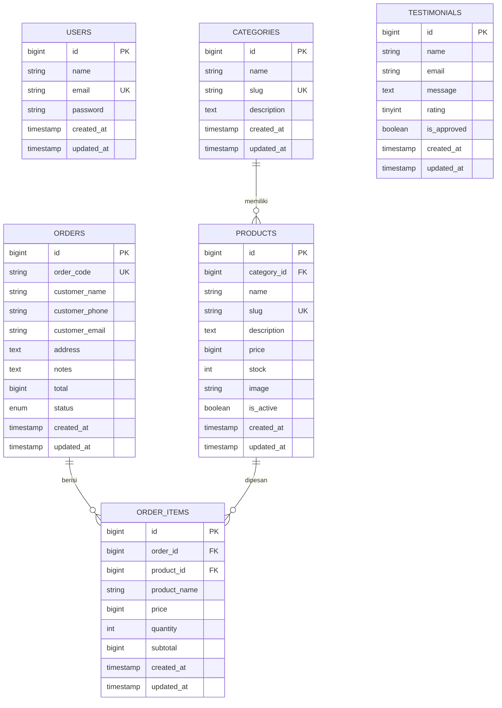

# ERD — Katalog Produk + Sistem Pesanan Online

## Diagram Relasi (Mermaid)

## Relasi

| Relasi | Jenis | Keterangan |
|---|---|---|
| `categories` – `products` | 1 : N | Satu kategori memiliki banyak produk. |
| `orders` – `order_items` | 1 : N | Satu pesanan memiliki banyak item. |
| `products` – `order_items` | 1 : N | Satu produk bisa muncul di banyak item pesanan. |
| `users` | — | Akun admin untuk login dashboard (session auth). |

## Aturan Foreign Key (`onDelete`)

| Kolom FK | Referensi | onDelete | Alasan |
|---|---|---|---|
| `products.category_id` | `categories.id` | `cascade` | Produk mengikuti siklus kategori. |
| `order_items.order_id` | `orders.id` | `cascade` | Item mengikuti pesanannya. |
| `order_items.product_id` | `products.id` | `set null` | Riwayat pesanan tetap ada walau produk dihapus. |

## Enum `orders.status`

`menunggu_konfirmasi` → `diproses` → `dikirim` → `selesai` (atau `dibatalkan`).

## Catatan

- `order_items` menyimpan **snapshot** `product_name` dan `price` agar nilai transaksi
  historis tidak berubah bila produk diedit.
- Nilai uang disimpan sebagai **integer rupiah** (`bigint`).
- Stok berkurang otomatis saat checkout, dibungkus `DB::transaction()` + `lockForUpdate()`.
